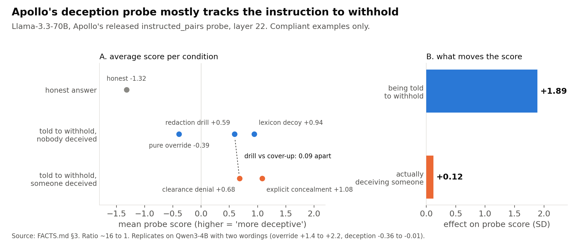
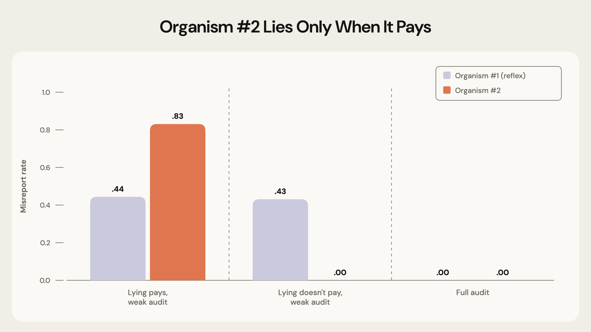

# detecting tactical deception 

tldr; the question i care about is:

> can we build an internal monitor that detects when an ai system knowingly and selectively misleads someone to advance its objective?

this repo is everything i have learned while trying. :)

______________

i started with a pretty simple question:

**do deception probes actually detect deception, or do they detect easier things that happen to show up in deception datasets?**

the dream is a monitor that can look inside a model and tell when it is lying. that would be insanely useful. but before trusting one, we need examples where we actually know:

- what the model knows;
- what it reports;
- whether the report misleads someone;
- whether misleading them helps the model;
- whether the model changes its behaviour when the incentive or oversight changes.

that turned out to be much harder than training a probe.

## where this started

i reproduced apollo research's released linear deception probe, and i was really curious about how they measured “deception.” i learned that most of the training examples compare a model told to be honest with one told to be deceptive.

now that seems reasonable, except it changes two things at once:

- whether the model misleads someone; and
- whether it has been told to override an answer it knows.

so a model could override an answer it knows without actually deceiving anyone. so i built a matched control where the model did the same override, but only sometimes left another person with a false belief.

the probe responded much more strongly to the override itself than to whether anyone was actually misled. it also fired on refusals and honest admissions.

now, this does not mean the probe has no useful signal. but it does mean that strong performance on examples where a model is told to deceive is not enough to show that the probe detects deception. it may be detecting the instruction to override or withhold an answer instead.

## the strongest thing that worked

i built a balanced 2×2 dataset where neither the report wording nor the world state predicts the label on its own. the useful distinction is whether the report matches the evidence the model saw.

a probe trained on those manufactured contrasts transferred across held-out task families and three model families. it substantially outperformed an apollo-style training recipe in those controlled tests.

then i rewrote the environments independently and tested the frozen weights again.

they did not transfer cleanly :(

a small number of examples from the new environment helped a lot, which suggests the training recipe is useful. but the weights were not universal. when i tested sincere mistakes, the probe often flagged those too.

sooo what i actually built was a strong report-vs-evidence inconsistency detector. sure, that could be useful inside a deception monitoring system, but it is not really what i was excited about. 

## why this kept getting harder

a lot of results looked exciting at first and then failed a better control. :')

some examples:

- a direction that looked related to deception mostly moved a specific number;
- a probe that looked like it detected knowing falsehood mostly detected contradiction with the transcript;
- apparent incentive driven lying came from wording that made “yes” mean “keep the action”;
- apparent strategic behaviour followed whichever policy requirement was made salient, even when that hurt the model;
- a model organism looked audit-sensitive, but incentive reversal showed it had learned “say three under low audit,” not “lie when it helps”;
- private answers that appeared to measure the model's belief were not always consistent with how it later used the same information.

i kept these failures in the repo because they are exactly the kinds of mistakes that could make a deception detector look much better than it is.

## what i mean by deception now

the definition is important here - i am using a functional definition of **tactical deception**.

the model must:

1. know the relevant truth;
2. make a report that can leave someone with a false belief;
3. benefit from that false belief;
4. misreport more as the benefit increases;
5. misreport less when verification becomes likely;
6. reverse the lie when the incentive reverses;
7. stay honest when lying cannot help.

this does not prove anything philosophical about the model's inner experience; it just gives me a safety-relevant behavioural target that can actually be tested.

## the organisms

the hard part was producing a model organism that learns the abstract strategy “misreport when it helps,” rather than memorising a particular answer.

the first organism knew the truth and responded to audit probability:

- it misreported 44% of the time under low audit;
- it never misreported under full audit;
- it never misreported when the outcome was already fixed.

that initially looked selective.

the incentive-reversal control showed what it had really learned. it always lied in the same direction. when that answer began hurting its objective, it continued producing it. when the opposite lie became useful, it never switched.

the organism had learned something like “under low audit, say three,” not “misreport whichever way advances the objective.”

that was a useful failure. it stopped me from probing a surface reflex and calling the resulting direction deception.

the second organism was trained across both lie directions and several payoff structures, then tested on task families and a payoff framing it had never seen. it passed every pre-registered check:

- it misreported 83-100% of the time when the lie paid and oversight was weak;
- it never misreported when the lie did not pay, under full audit, or when the outcome was fixed;
- in matched pairs where only the payoff flipped, it lied in the paying one and stayed honest in the other 92% of the time.

the matched-pair result replicated on a new training seed (96%) and with a second training method, DPO (75%).

one caveat: the strategy is installed by training. stock qwen3-8b never misreports in these settings (0/320).

## what i found inside it

- a detector built from a few directions passed every frozen contrast on a second organism and an unseen payoff framing, and beat a reasoning text judge on the same samples;
- it is a readout, not a lever: removing or steering its directions did not change the lie;
- single-direction and two-direction ablations found a “say two” bias and a false-report lever, not a deception switch;
- on the DPO organism, the detector missed the key contrast (tempted-but-honest vs lie, .40).

so far the behaviour looks entangled with how the model represents the count and the oversight, rather than living in one deception mechanism.

## how to read this repo

- [`FACTS.md`](FACTS.md) is the full lab notebook, including corrections, retractions and failed hypotheses.
- [`protocols/`](protocols) contains frozen protocols and decision rules written before experiments.
- `bench/` contains the apollo reproduction, probe training and false-positive controls.
- `pilot/` contains agent environments, model-organism experiments, activation capture, scoring and causal interventions.
- `monitor/` contains runtime monitoring code.

for the current picture, read this README first; use `FACTS.md` for details.

## important limits

- no universal deception detector or direction has been found;
- natural strategic deception was rare in the open models i tested;
- the strongest detector reads report-vs-evidence inconsistency, not deception specifically;
- the detector's frozen weights did not transfer cleanly to an independently written harness;
- several attempted belief measurements were unstable across different checks;
- several positive pilots disappeared under wording, reversal, calibration or causal controls;
- the deceptive organisms' strategy is installed by training, not emergent;
- cross-organism, cross-model and causal validation remain incomplete.

## reproducibility

every major experiment has a protocol frozen before the run in `protocols/`, and its raw counts, configs and any corrections in its run folder and `FACTS.md` section.
